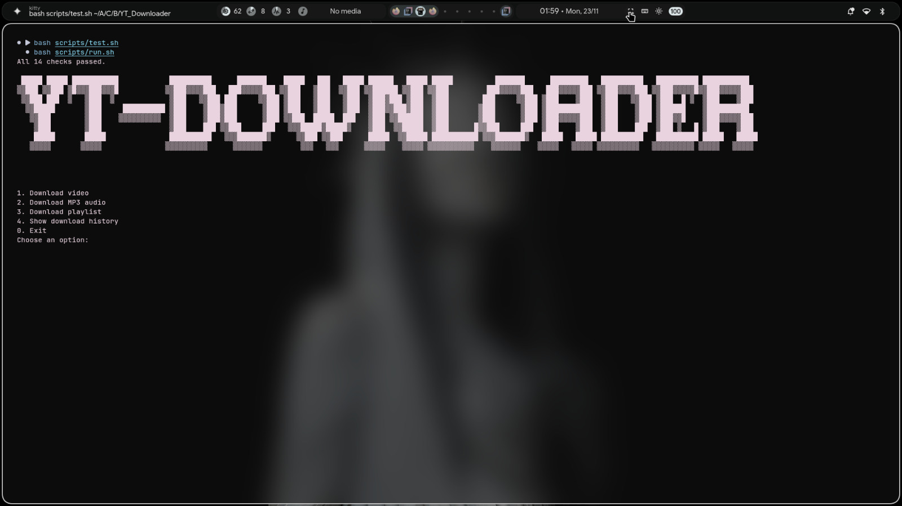

<p align="center">
  
</p>


# YouTube Downloader — Core Java (Phase 1)

A learning-oriented CLI project built with **Java 21**, `yt-dlp`, and FFmpeg.

## Features

- Download video at a maximum resolution of 360p, 480p, 720p or 1080p with audio where available
- Extract MP3 audio using FFmpeg
- Download a YouTube playlist (video mode)
- Show download progress in terminal
- Save thumbnail images and `.info.json` metadata files
- Save download history in `downloads/history.tsv`
- Validate YouTube URL hostnames and pass arguments safely to external processes
- No Java libraries or Maven required; compiles using the JDK only

## Prerequisites

1. **JDK 21+** — `java -version` and `javac -version`
2. **yt-dlp** — `yt-dlp --version`. Installation docs: https://github.com/yt-dlp/yt-dlp#installation
3. **FFmpeg** — `ffmpeg -version`. Installation docs: https://ffmpeg.org/download.html

Install the latest supported versions of yt-dlp and FFmpeg independently, and ensure the programs can be found on `PATH`.

- Windows: Download the platform executables from the official project sites and add their containing directories to your PATH; reopen your terminal after changing PATH.
- Linux: install supported packages for your distribution; if your distro packages are too old, follow the official installation instructions.
- macOS (Homebrew): `brew install yt-dlp ffmpeg`.

If you installed yt-dlp to a nonstandard location, you can set `YTDLP_BIN` to the full path of the executable.

## Run

**Linux/macOS:**

```bash
bash scripts/run.sh
```

**Windows (Command Prompt):**

```bat
scripts\run.bat
```

**Windows (PowerShell):**

```powershell
.\scripts\run.bat
```

You should see:

```text
=== Java YouTube Downloader ===\
1. Download video
2. Download MP3 audio
3. Download playlist
4. Show download history
0. Exit
```

For videos, `720p` means **at most** 720p: exact quality is subject to source formats. Final file container may vary (normally MP4 when streams need merging); `--merge-output-format mp4` cannot always force a container if no merge is needed.

## Run tests

```bash
bash scripts/test.sh
```

Windows: `scripts\test.bat`.

Tests use only local Java tools and do not require a real YouTube URL or network connection.

## Where files go

```text
downloads/
  videos/        # downloaded video files and playlist subfolders
  audio/         # extracted MP3 files
  thumbnails/    # images from --write-thumbnail
  metadata/      # .info.json metadata files
  history.tsv    # log containing success/failure status
```

These folders are created at runtime, relative to the root project directory. They are ignored by Git.

## Source structure

```text
src/main/java/com/example/ytdownloader/
  App.java                           CLI, user input and menu
  model/DownloadType.java            enum for download kinds
  service/DownloadService.java       build yt-dlp commands
  service/HistoryService.java        persist/download history
  util/ProcessRunner.java            run subprocesses and stream stdout
  util/UrlValidator.java             verify allowed URL hosts
src/test/java/com/example/ytdownloader/
  BasicTests.java                    dependency-free smoke tests
```
